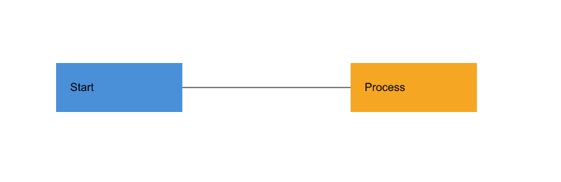

# Lab1 Phase 1 最终验收报告

验收日期：2026-10-30（Asia/Shanghai）。依据：仓库内 `phase_cli_1.md`。
本报告记录本地实际完成的检查；GitHub Actions 的远程执行结果不在本地验收结论内。

## 可复现检查

```sh
npm ci
npm run check
npm run render:acceptance
```

实际环境：Node.js v22.23.3、npm 10.9.9、TypeScript 5.9.3、macOS arm64。
本地已从 package-lock.json 重新安装依赖（使用 npm 离线缓存），类型检查、构建、129 项测试全部通过，无跳过项。
渲染脚本使用开发依赖 @resvg/resvg-wasm 2.6.2，离线生成 SVG、PNG 和 CLI 输出，不需要浏览器或外部服务。
脚本优先选择本机 Arial/DejaVu Sans；其他系统可用 SVG_ACCEPTANCE_FONT 指定 TTF 文件。

## 要求与证据

| 作业要求 | 实现与验收证据 | 结果 |
|---|---|---|
| 19 个命令与 help 语法 | Main 注册检查；各命令参数与真实 CLI 测试 | 通过 |
| 六种图形、唯一且区分大小写的 ID | model/commands/io 测试；工厂未知类型报错 | 通过 |
| in 归属、嵌套组、统一 move/scale/set/delete | 六类型测试、递归操作及版本 A 回放 | 通过 |
| group/ungroup/addto/front/back | 同父级/跨父级/防环/根级解组限制/同级顺序测试 | 通过 |
| undo/redo 一条命令一个单元 | 十种编辑各三轮恢复；多步依赖、删除子树与跨父级分组恢复 | 通过 |
| 新编辑清 redo；失败不改变状态 | 成功零距离移动、非法编辑、候选多步失败、读写失败测试 | 通过 |
| init/read/save/canvas 文档屏障 | 成功后锁定、下一次成功编辑解锁；失败保留双栈 | 通过 |
| 显示跳过历史、错误前缀、提示符及注释 | CLI 子进程、交互记录；颜色参数与整行注释区别 | 通过 |
| save/read 与外部缺 ID 警告 | 六类型 round-trip、特殊字符、全文件显式 ID 预留、真实文件错误 | 通过 |
| 作业第 6 节完整会话 | acceptance.test.mjs 从原文提取命令、XML 与预期输出执行 | 通过 |
| 作业第 6.1 节版本 A | 从原文提取会话执行，检查最终 8 个元素与中文文字 | 通过，见差异说明 |
| TypeScript OOP、一类一文件 | TypeScript AST 检查所有 48 个源文件的类名/文件名及顶层自由函数 | 通过 |
| 模块依赖方向与无环 | AST 检查所有相对 import（含类型引用）、模块白名单及依赖图 | 通过 |
| Command 与 Composite | EditCommand 实现应用拥有的 UndoableEdit；Group 多态递归 | 通过 |
| 名字分派仅两处 | 人工复核 CommandDispatcher 与 ShapeFactory；编解码无图形类型 switch | 通过 |
| 架构/过程/一致性/质量文档 | doc/README.md；组件图、历史类图与本报告 | 已补齐 |
| 分步 Git、推送与 final 标签 | 保留前五阶段提交；本阶段最终提交后建立 annotated final 并推送 | 交付步骤 |

## 发现的问题及处理

1. **保存覆盖会改变原文件权限**：原实现用默认权限建立临时文件再替换，可能将 0600 文件变为 0644。
   已在写入前读取现有权限，替换前对临时文件恢复原权限；回归测试确认覆盖后仍为 0600。
2. **示例树省略显式属性**：第 6.1 节版本 A 的命令为连接线设置了 black stroke，但示例树未显示 stroke。
   程序保留并显示显式 `stroke=black`；验收预期只补充这一属性，并只忽略列对齐空格。原作业文件未修改。
3. **架构自查原先只有抽样**：现已增加源文件 AST 全量检查，限制模型/应用/命令/CLI/IO 的依赖方向并检查环路。
4. **图表仅有 PlantUML 源码，不便在 GitHub 直接看图**：补充相同组件依赖的 SVG 图，并保留 PlantUML 组件图和历史类图源文件。

## 视觉验收

生成过程：执行 `examples/final-flowchart.commands`，经过整组移动、undo/redo、save/read，再用离线渲染器读取实际保存的 SVG。
检查结果：800×260 画布、两个不同颜色的矩形、矩形内 Start/Process 文字，以及两者之间的黑色连线均正常。



- [保存产物 SVG](acceptance/flowchart.svg)
- [完整 CLI 输出](acceptance/flowchart.transcript.txt)
- [组件依赖图](architecture.svg)；[PlantUML 源码](architecture.puml)

本地文件 URL 被内置浏览器的协议安全策略拦截，因此未声称完成真实浏览器截图验收。
已采用不涉及浏览器访问或网络的离线渲染；用户仍可将上述 SVG 直接拖入本机浏览器自行查看。

## 已知边界与交付说明

- read 支持当前六种类型及白名单属性；transform、CSS/style、其他标签/属性、DOCTYPE、复杂 viewBox 和混合文本标签会明确拒绝。
- 普通组的样式遵循继承；解组不把继承样式实体化到子节点，可能改变解组后的继承外观。
- 使用全量前后快照，历史内存随节点数和编辑次数增长；未承诺大文档性能或文件写入的并发锁/断电持久性。
- 原文件权限位保留；不承诺保留 ACL、扩展属性、注释、XML 排版和文件 inode。第三方类型声明兼容问题使用 skipLibCheck，项目源码仍严格检查。
- box 和插件系统属于后续阶段，本阶段不实现。上述边界与架构方案中的范围一致。
- 课程材料未给出截止日期。final 标签的实际提交时间可由 Git 核对，无法据此证明早于未提供的截止时间。
- GitHub Actions 已配置 npm ci、check 和离线渲染；本报告不把“已配置”写成“远程 CI 已通过”。
