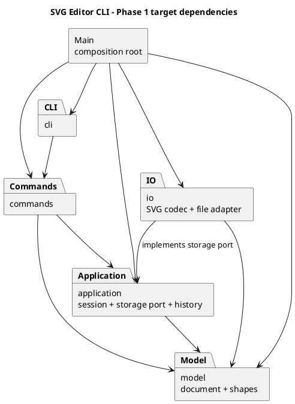

# Lab1 Phase 1：架构草案与开发记录

版本：v0.5，2026-10-30。已完成里程碑 5（SVG 文件读写），下文明确区分已实现内容与后续设计。
需求依据为项目内的 [phase_cli_1.md](../phase_cli_1.md)。

## 一、架构方案

### 1. 范围与约束

本阶段使用 TypeScript、面向对象和 Command 模式，实现基于 ID 操作的 SVG CLI 编辑器。
内置类型仅为 `rect`、`circle`、`ellipse`、`line`、`text`、`g`；`box` 和动态插件系统属于后续阶段。
每个生产代码类单独一个同名文件；字段封装，图形行为通过多态表达，不采用公共数据袋配合过程式分派。

当前已实现：Node.js/TypeScript 工程配置、REPL、参数分词、命令分发、`help`，以及六种图形、
画布文档、工厂、组合结构编辑、几何与样式校验、独立快照和模型测试。
现已通过 `EditorSession` 接通全部十种编辑命令，支持 undo/redo、init/canvas/tree/show/help。
每条成功编辑命令独立记录前后快照；文档修改与历史变化共同提交。read/save 已接入；完整综合验收留到第六步。

### 2. 模块划分

| 模块 | 职责与计划中的主要类 | 当前状态 |
|---|---|---|
| `src/Main.ts` | 组合根：创建对象、注册命令、注入依赖、启动程序 | 已实现最小组装 |
| `src/cli/` | `Repl` 处理终端输入输出；`CommandTokenizer` 处理空白、双引号、整行注释 | 已实现 |
| `src/commands/` | 命令基类、`EditCommand`、按请求创建实例的分发器、具体命令和 `TreeFormatter`；编辑命令拥有前后快照及恢复行为，不操作终端或文件系统 | 全部命令已接入 |
| `src/application/` | `EditorSession` 管理当前文档；`CommandHistory` 管理双栈及文档屏障；`UndoableEdit` 为应用拥有的命令端口，`HistoryResult` 为内部返回值接口 | 会话、历史、init/canvas 屏障已实现；DocumentStore 存储端口与默认路径已实现 |
| `src/model/` | `SvgDocument`、`Shape`、`GeometricShape`、六种图形类、`Geometry`、`Style`、`ShapeFactory`：管理几何、样式、树结构、唯一 ID 与顺序 | 已实现并接入 CLI |
| `src/io/` | SvgCodec 使用 saxes 解析 XML、统一序列化模型；SvgFileStore 实现文件存储端口，SvgNode 仅作 XML 传输节点 | 已实现 |
| `tests/` | 分词、模型、命令/会话、历史及真实 CLI 场景；后续增加 SVG IO 验收 | 124 项测试通过 |
| `examples/` | 可通过标准输入回放的命令脚本，不参与生产模块依赖 | 第三/四阶段脚本、第五阶段读写脚本与外部 SVG |
| `doc/` | 方案、PlantUML 图、真实过程记录、自查与质量说明 | 草案 |

图中的箭头表示“源码依赖”。这是当前模块的依赖规则；各模块均已有实现。
可渲染的图源同时保存在 [architecture.puml](architecture.puml)。

### 3. 设计模式的选择与落地

**Command（必须使用）**

所有命令继承 `Command`；`CommandDispatcher` 按命令名找到创建函数，每次请求创建新实例，REPL 不认识具体命令。
十种编辑命令继承 `EditCommand`：create/delete/move/scale/set/group/ungroup/addto/front/back。
`EditCommand.execute` 将自身交给 `EditorSession.executeEdit`，由 `CommandHistory` 按应用层的 `UndoableEdit` 接口调度。
应用层只依赖自己定义的端口与模型，不反向导入 `commands`；接口图见 [history.puml](history.puml)。

`EditCommand` 先克隆候选文档，再调用具体编辑逻辑；成功后保存前态、后态和反馈消息，历史层才入栈、清空 redo 并解除文档屏障。
命令对象只能成功执行一次，避免一次新执行覆盖已经入栈的快照。旧测试中的复用命令实例方式已相应改为每次创建实例。
`undo` 调用该命令的恢复方法返回前态副本，`redo` 返回后态副本，不重放原参数，也不通过逆算术撤销。
克隆保留具体图形类型、属性、文本、父子关系及节点顺序；不可变的几何/样式值可安全共享，不用 JSON 数据袋替代模型。
显示和文档类命令直接调用查询或会话方法，不进入编辑历史；没有新增按命令名判断历史策略的分派。

对作业规模而言，快照比逐个编写 `group/delete/ungroup` 的逆操作更容易验证；每个历史单元保存两份文档快照，内存随节点数和历史长度增长。
当前不限制历史长度；编辑时还会构造临时候选文档。这是明确接受的作业规模折中。
若后续需要处理大文档，再将具体命令改为保存最小差异，命令调用协议保持稳定。

**Composite（需求要求的容器与叶子统一语义）**

现已定义抽象 `Shape`，封装 ID 和样式，提供 `move/scale/set/clone/walk` 等操作。
`Rect/Circle/Ellipse/Line/Text` 定义自身几何属性，`GeometricShape` 复用不可变 `Geometry` 的几何运算，
`Group` 递归组合子图形。`Style` 封装公共样式白名单。
图形变换返回新对象；`SvgDocument` 统一接纳修改。属性和子节点数组冻结，避免从读取接口绕过校验。
相较 v0.1，父级不再存储为可变反向指针，由 `SvgDocument.parentOf(id)` 从树推导，避免移动或克隆后指针失配。
命令只调用抽象行为，不能到处 `switch(tag)`。
树结构的插入、删除、重排由模型管理，统一验证 ID 唯一性、父级合法性和无环约束。
普通组的 `set fill/stroke/stroke-width` 设置组自身的 SVG 样式属性，遵循 SVG 继承；不擅自改写已有显式子样式。
`box` 的定制属性传播不在本阶段实现。

显示也通过多态：`Shape.summary()` 返回类型、ID、几何描述及显式样式，具体类定义自己的几何描述；
`movementSummary()` 为叶子返回新位置，为组返回移动增量。`TreeFormatter` 仅排布树形连线和缩进，
不按类型名判断。所有这些方法只生成字符串，实际终端输出仍由 `Repl` 完成。
这让模型知道简单的文本描述格式，是有意的折中；如果未来出现多个复杂展示端，再评估独立展示接口。

**Factory（集中类型创建）**

现已由 `ShapeFactory` 集中处理六种类型名到图形类的映射，以及创建参数数量、数值和可选样式。
`CreateCommand` 已复用此创建入口；SVG 读入通过同一工厂的 fromSvg 入口创建节点，不另建类型分派表。
图形自己的属性校验、显示描述和几何行为归相应类所有；工厂不承包图形行为。
SVG 编解码也应通过多态或注册的类型适配器工作，避免在读入和保存时分别新增按类型分派点。
可使用中立的 XML 节点描述作为模型与 IO 的转换边界；模型不导入具体 XML 库。

**按名字分派的两个允许位置与待重构项**

1. `CommandDispatcher`：命令名 → 命令创建函数，已改为按请求创建独立执行对象；仍是允许的名字分派点，后续插件化阶段再评估注册生命周期。
2. `ShapeFactory`：图形类型名 → 图形类，现已实现为六项映射表；后续插件化阶段评估替换为 `ShapeProvider` 注册入口。

即使用映射表代替 `switch`，上述两处仍属于按名字分派，按作业要求列为待重构项。
本阶段不预先实现插件加载、发现或热更新。

### 4. 依赖方向规则

| 模块 | 允许依赖的项目模块 | 原因 |
|---|---|---|
| `model` | 本模块内部 | 图形规则不依赖终端、文件系统、命令或应用会话 |
| `application` | `model` | 统一调度文档和历史，存储能力通过自己定义的端口注入 |
| `commands` | `application`、`model` | 把用户意图转为模型操作，不决定具体 IO 实现 |
| `cli` | `commands` | 只做输入解析、命令调用、结果呈现；终端边界允许依赖 Node readline |
| `io` | `application` 的端口、`model` | 实现端口并适配文件系统/XML；应用层不反向导入 IO |
| `Main` | 所有生产模块 | 仅在组合根创建和连接具体对象 |
| `tests` | 被测试模块 | 测试可以跨层验证，生产代码不得导入测试 |

禁止循环依赖。`application → io`、`model → cli`、命令直接使用 `node:fs` 都是待处理的违规依赖。
接口使用 `import type` 表达纯类型依赖。当前没有必要额外引入依赖注入框架。

### 5. 关键行为决策

- **失败原子性**：模型在不可变候选子树上完成修改和唯一性校验，全部成功后才一次替换文档根节点数组。
  应用层再用候选文档隔离整条命令：参数、模型校验或执行失败时，当前文档对象与两个历史栈保持不变。
  撤销/重做先成功生成恢复副本与消息，再移动栈顶；read 在完整解析后才替换文档与路径；save 在文件替换成功后才更新默认路径和历史。
- **历史粒度**：一条成功编辑命令一个单元，包括零距离移动等成功但状态未变的命令。分组多个节点、删除整棵子树均只入栈一次。
  撤销后的新成功编辑清空全部 redo；失败编辑保留两个栈。tree/show/help 与无参数 canvas 都跳过历史且不清 redo。
- **文档屏障**：成功的 `init` 与带参数的 `canvas` 清空旧历史并禁用 undo/redo，报 `undo not allowed after io command`，直到下一次成功编辑。
  即使 canvas 修改前后尺寸相同也会触发屏障；非法 init/canvas 保留原文档与历史。成功的 read/save 现已复用同一历史重置策略。
- **历史提示**：无文档时先报 no document；解除屏障后空栈分别报 `nothing to undo` / `nothing to redo`。
  move/set/delete 的撤销反馈描述恢复后的坐标、值或父级；其他编辑撤销使用 `undone: <原成功摘要>`，重做回显原成功摘要。
- **容器操作**：移动和缩放对所有后代生效；缩放同时改变位置和尺寸，因子必须大于零。先以修改几何值实现编辑器自产 SVG，不用未经测试的 transform 替代命令语义。
- **顺序与结构**：模型保存有序子节点。根级 `<g>` 按题目要求禁止解组；嵌套解组时子节点占据原组的位置。
  `addTo` 移入目标容器末尾，同父级调用也移到末尾；拒绝容器移入自身或后代。删除容器删除整棵子树。
  `front` 将节点置于同级数组末尾（SVG 最后绘制、视觉最前），`back` 置于开头。
- **分组约定**：选择节点不能重复或同时包含祖先与后代。新组放到所有选中节点的最近公共父级；
  无共同 `<g>` 则放到画布根。插入到该父级下第一个包含选中节点的分支之前；子节点按原文档前序顺序排列，
  不按参数顺序排列。被移空的旧组保留。该约定补足原文未明确的跨父级放置规则，已用测试固定。
- **数值约定**：坐标允许负数和浮点；尺寸、半径与 stroke-width 非负，允许零；画布尺寸严格为正。
  所有数值和计算结果必须有限，拒绝 NaN/Infinity/溢出；数值文本只接受十进制形式（含指数），不接受空白串、单位或十六进制。
- **ID**：创建与分组要求显式 ID，大小写敏感且全文档唯一。读入时先收集显式 ID，再为缺失项生成不冲突的“标签名+序号”，成功提交后输出警告。
- **文本与样式**：文本内容与 XML 属性分开存储，保存时分别转义。省略 fill/stroke 时保持属性缺省，不填入人为默认值。
- **CLI**：仅整行去掉前导空白后以 `#` 开头才视作注释；双引号保留空格与空字符串。当前未额外定义引号转义扩展。错误统一由 REPL 输出为单行 `error:`，帮助可在无文档时使用。
- **初始化**：`init` 接受 0～2 个参数，缺省为 800×600，只有宽度时高度为 600；先构造并验证新文档再替换会话。非法初始化保留原文档。
- **画布与属性查询**：`canvas` 无参数仅返回尺寸；一个参数修改宽度并保留当前高度，两个参数同时修改宽高，图形坐标不变。
  `show id` 显示父级（根级为 svg）、完整几何属性名、显式样式与文字内容；不会把继承值或 SVG 默认值伪装成显式属性。
- **创建与归属**：先取得当前文档，再解析类型和 ID，仅把类型参数末尾完整的 `in <containerId>` 对视为父级声明；
  不扫描或拆分文字内容中的 `in`，也不把 ID `in` 解释为关键字。其余参数由唯一的图形工厂校验。
  缺失、重复或不在尾部的结构参数按类型参数数量/数值规则拒绝；单个末尾 `in` 仍可能是合法文本或样式值，不擅自删除。
- **树形显示**：`tree` 显示 `svg (宽x高)` 及全树，`tree id` 以指定节点作为无前缀根；
  显示关键几何属性与显式样式，文字用 JSON 字符串转义防止换行破坏结构。属性之间用单空格，不额外对齐列宽。

### 6. 变化点假设

| 可能变化 | 本阶段准备 | 暂不实现的部分及原因 |
|---|---|---|
| 更多图形与未来 `box` | 图形多态、集中工厂、统一子树操作 | 不实现插件加载器，当前只要求六种内置类型 |
| GUI 或 agent 入口 | 终端 IO 与命令对象分离 | 不做图形界面和网络服务 |
| SVG/XML 库或存储位置 | IO 适配器与存储端口 | 不做云存储、多个存储后端 |
| 更复杂撤销策略与大文档 | 独立历史策略，命令封装恢复行为 | 不提前优化快照为增量历史 |
| 新属性、输出格式 | 图形类提供描述，TreeFormatter 排布树，CLI 负责终端输出 | 不提前引入 Visitor 或完整展示框架；不支持白名单以外的任意 SVG/CSS |

### 7. SVG 读写边界与路径决策

- `DocumentStore` 与 `LoadedSvg` 定义于 application，io 实现端口；会话不依赖 XML 库或文件系统。
- `SvgCodec` 使用 saxes 6.0.0 解析 XML，不用正则表达式解析 XML。新增 `ShapeDefinition` 将几何参数 schema、是否接受文字、创建函数放进原有工厂的同一张注册表；CLI 与 SVG 共享类型创建与校验，无第三处图形类型分派。
- 支持 rect/circle/ellipse/line/text/g，几何属性、fill/stroke/stroke-width、唯一 ID。先收集全文显式 ID 再为未命名节点分配不冲突 ID；重复或空的显式 ID 报错，警告只在整份文档成功读入后输出。
- SVG 根只接受 width/height/viewBox 与命名空间声明；画布缺省 800×600，缺省几何数值为 0，viewBox 必须等于 `0 0 width height`。数值不接受百分比或 px 后缀。
- 接受 SVG 命名空间（可带前缀）或无命名空间、CDATA、XML 注释。文字保留，注释和排版不保留；嵌套最多 128 层。
- 明确拒绝其他标签/属性（含 transform、style、font-size、data-kind）、混合文本子标签、DOCTYPE、自定义实体、处理指令和非 SVG 命名空间。不承诺通用 SVG 导入，也不静默丢弃这些内容。
- 文件按严格 UTF-8 解码，非法字节拒绝。保存转义 &、尖括号、双引号和控制空白，保持文字及属性中的换行/回车/制表符；非法 XML 字符在写文件前拒绝。
- 成功 read 设定默认路径；显式 save 成功后更新默认路径；save 无参数使用该路径，无默认路径时报错。init 清除默认路径，resize/编辑/undo/redo 保留路径；路径不是编辑快照的一部分。
- 文件路径相对进程当前工作目录解析。读取失败报 `cannot read file: ...`；XML/子集验证失败报 `invalid SVG: ...`；文件写入失败报 `cannot write file: ...`。所有错误由 REPL 统一加 error 前缀并压成单行。
- 保存先编码验证，再在目标同目录写唯一临时文件，最后 rename 替换；失败清理临时文件。失败读写保持原文档、默认路径和双栈；成功 read/save 清空历史并启用文档屏障。
- saxes 的旧声明文件在当前 TS 严格配置下存在泛型/可选属性兼容问题，因此启用 skipLibCheck，仅跳过第三方声明文件检查，项目源码保持 strict/noUncheckedIndexedAccess/exactOptionalPropertyTypes 等严格检查。

### 8. 模型接口与当前限制

- `ShapeFactory.create(type, id, args)` 创建脱离文档的图形；`SvgDocument.add(shape, containerId?)` 接入文档。
- `SvgDocument.move/scale/set/delete/group/ungroup/addTo/front/back` 是模型编辑入口；所有 ID 查找大小写敏感。
- `get/find/parentOf/children/walk/size` 提供只读查询；编辑后应重新按 ID 获取对象，旧引用仍代表编辑前的状态。
- `clone()` 产生独立可编辑文档，保留全部类型、内容、样式和顺序，现已用于历史记录和恢复。
- 应用侧所有可撤销修改必须经过 `EditCommand` 与 `EditorSession.executeEdit`，不可直接修改 `session.document` 后期待历史自动记录。
  模型的独立编辑 API 保留用于模型测试及后续读入；会话切换到新的文档副本后，调用方应重新取得 `session.document`。
- 为保持作业规模下的简单可靠，当前采用树遍历查找并重建候选容器，未维护全局可变索引；
  层次很深或节点很多时存在遍历/复制成本，后续有实际性能证据时再优化。
- 普通分组样式遵循 SVG 继承；解组按要求移除组并提升子节点，不额外把继承样式实体化到子节点。
  带组样式的解组可能改变继承后的外观，当前无“解组后视觉保持不变”的额外承诺。
- 模型没有 XML、终端或文件 IO；不支持 transform、box 或插件。CLI 已支持全部命令。
  外部 SVG 仅支持上节约定的可编辑子集；最终综合验收与 final 标签仍待后续。

## 二、过程记录

只记录已发生的讨论和实际修改；后续测试结果和问题修复在发生后追加，不预写成功结论。

### 2026-10-30：里程碑 1

1. 用户先要求理解作业。阅读 `phase_cli_1.md`，确认 TypeScript 面向对象、Command 模式、Git 分步提交、文档与最终 `final` 标签是硬要求，`box` 不在本阶段范围。
2. 用户授权先完成架构草案、项目骨架、第一次提交，并提供 `sqaaia/svg-editor-cli` 仓库。
3. 检查工作区，发现 `hw1` 仅有作业说明，尚无 Git 仓库。选择以 `hw1` 为独立仓库根目录，保留原作业文件，避免把其他课程目录纳入这个仓库。
4. 在初步的 `cli/commands/model/io` 划分中补充 `application`，用于隔离会话、历史和存储端口，避免让 REPL 或命令分发器逐渐承担全部状态管理。这是架构草案的首次细化。
5. 决定先落地 `help` 与命令入口，不生成整套编辑器。帮助文本明确标注未来命令未实现，保留可核验的分步开发过程。
6. 初始检查覆盖引号文本、空文本、十六进制颜色，以及脚本输入遇错后继续执行。原因是整行注释与颜色都含 `#`，简单截断可能误删合法参数。

后续每个里程碑记录：具体问题 → 证据/复现 → 决策与修改 → 验证结果及对应提交。

### 2026-10-30：里程碑 2

1. 用户要求继续实现图形模型和分组，补测试、更新文档并提交推送；因此本次只推进模型层，不提前接入全部编辑命令。
2. 设计复核时，针对“命令失败不改变任何状态”，选择不可变图形配合文档原子替换；
   相比逐个就地修改子节点，这使组内任意后代失败时自然保留原状态。测试使用后一个节点的浮点溢出验证该保证。
3. 将原方案的父级字段改为由文档树推导，避免双向关系带来的维护负担；添加 `Geometry`、`Style` 和 `GeometricShape` 值对象/基类复用校验与运算。
4. 对说明中未明确的跨父级分组采用最近公共父级与原文档前序顺序，并测试逆序参数、同父级、跨父级和跨根分支场景。
5. 特别区分 `front` 的视觉层叠与数组位置：SVG 后绘制的节点应位于数组末尾；对应测试验证同级顺序，保证不会跨父级移动。
6. 回放作业第 6.1 节版本 A 的模型操作，验证节点 2 的矩形与文字一起下移，节点 1 和连接线保持原坐标。
7. `npm run check` 通过：28 项模型测试与原有 2 项 CLI 测试。测试还覆盖 ID 冲突、防环、只读集合、属性白名单、克隆隔离和失败原子性。

### 2026-10-30：里程碑 3

1. 用户要求接入 init/create/tree/move，补测试、更新文档并提交推送。新增 `EditorSession` 统一持有当前文档，
   具体命令在执行前检查会话，只有 help 和 init 可在未初始化时使用（read 留待后续）。
2. 将原分发器的命令实例注册改为命令创建函数注册。这样现在的创建/移动命令每次都是独立对象，后续加入撤销记录时不会共享可变执行状态。
3. 显示设计中避免在 `TreeCommand` 新增类型 switch：改为具体图形通过多态提供几何描述和移动摘要，
   `TreeFormatter` 只处理树形连线。此处保留模型对轻量文本描述的认识，文档记录了取舍。
4. 针对 `in` 既可能是结构关键字也可能是文字/ID，限定只解析类型参数末尾完整的两项后缀；
   用文字内容为 `in`、ID 为 `in`、空文字、含空格与颜色的真实 CLI 测试确认不会误拆。
5. 添加非法 init 保留原文档、非法创建/移动保留原节点数组、无文档错误、错误后继续处理下一行等测试。
   输入参数错误由命令拒绝，图形与树结构约束继续由模型保证，避免复制校验规则。
6. 新增 `examples/milestone3.commands`。用真实 CLI 子进程回放作业流程图的创建/移动/查看部分，
   精确比对输出：节点 2 的矩形和文字下移 100，节点 1 与连接线不变。
7. `npm run check` 通过，共 48 项测试（新增 18 项命令/会话/CLI 测试，保留原有 30 项）。

### 2026-10-30：里程碑 4

1. 用户要求实现 undo/redo 与其余编辑命令，补测试、更新文档并提交推送。本次接入十种编辑命令的统一历史，
   同时补上 canvas/show，以便直接验证“文档修改触发屏障、查询跳过历史”；read/save 仍留到下一步。
2. 为避免让应用层反向导入具体命令，新增应用层端口 `UndoableEdit`，由 `EditCommand` 实现；
   `CommandHistory` 持有端口实例的双栈，具体命令负责快照与恢复行为，更新类图记录该依赖决策。
3. 不仅依赖模型的单次操作原子性，还将整个命令放在独立候选文档上执行。测试专门构造了先移动、再删除、最后抛错的命令，
   确认原文档对象及 redo 都保留；避免今后复合命令只完成一半却污染用户状态。
4. 对每种编辑执行“前态 → 编辑 → 撤销 → 重做”并比较尺寸、具体类型、属性、文字、父级及顺序；
   重复三轮验证快照稳定。另覆盖跨父级分组、多步依赖操作、删除子树、属性从缺省到显式再撤销等情况。
5. 对失败编辑、查询、参数错误、空历史、init/canvas 屏障、同尺寸 canvas 和成功的零距离移动分别验证历史策略。
   原有命令单元测试改为每次创建新编辑实例，与生产分发器的一次执行一实例约定一致。
6. 新增 `examples/milestone4.commands`，真实 CLI 回放包含全部十种编辑命令、undo/redo、show 与 canvas 查询；
   另一条错误会话验证屏障/空栈/非法缩放的错误输出及后续命令继续执行。
7. `npm run check` 通过：新增 40 项历史/编辑测试，连同原有 48 项共 88 项全部成功。

### 2026-10-30：里程碑 5

1. 用户要求实现 read/save、测试、文档及提交推送。新增应用层存储端口，组合根注入 SvgFileStore，保持 application 不导入 io。
2. 工厂原有注册表扩展为 ShapeDefinition，将 CLI 构造函数与 SVG 几何 schema 放在同一处；编解码通过容器/文字能力查询序列化，不新增类型 switch。
3. 实现前统一缺失 ID、默认保存路径与外部 SVG 子集的约定。选择两遍扫描 ID，避免早期匿名节点占用后面显式命名节点的 ID。
4. XML 库声明文件的严格类型检查失败，经检查定位为第三方声明兼容问题，启用 skipLibCheck；项目源码的严格检查继续开启。
5. 测试验证六种图形、嵌套/顺序、特殊文字和样式缺省的保存读回等价；未知语义明确报错。补充非法 UTF-8 测试，避免字符替换导致静默损失。
6. 文件保存采用同目录临时文件再替换，验证不可写目标、缺失父目录和编码失败不会破坏已有文件；失败读写保持 redo 与默认路径。
7. 新增 examples/external.svg 与 milestone5.commands，可实际生成并读回 demo.svg。read/save 的成功屏障与失败后继续执行均通过真实 CLI 子进程测试。

## 三、一致性自查

### 1. 模块划分

当前目录与本版方案一致。`model` 包含 13 个同名类文件（含新增 ShapeDefinition）；`application` 包含会话、历史及四个端口/结果接口；`io` 占位已替换为 SvgCodec/SvgFileStore/SvgNode 三个类。
`commands` 包含基类、编辑基类、分发器、格式化器与全部具体命令。`examples` 提供第三至第五阶段脚本。
相较 v0.1，新增的几何/样式值对象和共享几何基类、父级关系表示方式已在方案及过程记录中修订。
`src/Main.ts` 是唯一组合根，各生产类单独文件，文件名与类名一致。

### 2. 依赖方向

初始代码抽样：`Main → Repl/CommandDispatcher/HelpCommand`；`Repl → CommandDispatcher/CommandTokenizer`；
`HelpCommand/CommandDispatcher → Command`。`CommandTokenizer` 无项目外部依赖。
终端依赖留在 `Repl`，命令层通过返回值提供输出；未发现违反本版规则的依赖。
本次新增模型类仅导入模型内部类；`SvgDocument` 通过 `Shape` 行为操作节点，没有按类型字符串判断几何行为。
图形类型名分派仅位于 `ShapeFactory`；没有引入其他 `switch(tag)` 或 `instanceof` 类型分派。
第三阶段抽样：`InitCommand → EditorSession/Geometry`，`CreateCommand → EditorSession/ShapeFactory`，
`MoveCommand → EditorSession/Geometry`，`TreeCommand → EditorSession/TreeFormatter`，`TreeFormatter → model`，
`EditorSession → SvgDocument`。`Main` 创建模型工厂的依赖已补入 PlantUML 图；未新增反向依赖或 IO 泄漏。
第四阶段抽样：`EditCommand → EditorSession/UndoableEdit/SvgDocument`；`EditorSession → CommandHistory`；
`CommandHistory → UndoableEdit/HistoryResult/SvgDocument`。后两者仅在应用/模型内部依赖，不导入 commands。
`HistoryResult` 只用于跨对象传递已验证的文档与反馈，未替代领域模型；所有生产类仍一类一同名文件。
待未来模块实现后，重新检查实际 `import` 与模块图，不能沿用当前结论作为最终验收。

## 四、质量保证手段

### 1. 当前检查方式

- `npm run typecheck`：开启 TypeScript 严格检查、索引未定义检查及 override 检查。
- `npm test`：先构建，再使用 Node.js 内置测试运行器验证模型行为、分词边界和真实 CLI 子进程。
- `npm run cli`：人工检查交互启动、`svg>` 提示符、`help` 和 EOF 退出。
- 依赖版本通过 `package-lock.json` 锁定；使用 `npm ci` 验证可重复安装。

当前测试验证了模型、全部编辑命令、撤销重做、显示以及 init/canvas 的行为；SVG 读写和真实文件 IO 现已覆盖；最终综合自查仍待第六步。

2026-10-30 本地验证结果：Node.js v22.23.3、TypeScript 5.9.3；`npm run check` 通过，包含类型检查、构建及 2 项自动化测试。
另外以真实交互终端启动，确认启动横幅、`svg>` 提示符和 `help` 输出。

里程碑 2 验证：同一运行环境下 `npm run check` 通过，包含严格类型检查、构建和 30 项自动化测试（28 项模型、2 项 CLI）。
复核模型依赖方向与类型分派，未发现跨模块依赖或额外图形类型分派。

里程碑 3 验证：`npm run check` 通过，类型检查、构建与 48 项测试全部成功。
新增测试以真实 CLI 子进程逐项验证六种类型的创建、显示、移动和 `in` 归属，另以完整脚本验证嵌套树与整组移动。
`tests/commands.test.mjs` 是本阶段主要验收入口；`examples/milestone3.commands` 可由用户自行回放。
另以真实交互终端验证 README 中的 init/create/move/tree 示例，确认提示符、中文输出、整组移动后的坐标以及 Ctrl-D 退出正常。

里程碑 4 验证：`npm run check` 通过，共 88 项（40 项历史/编辑、28 项模型、18 项原命令/会话、2 项 CLI）。
`tests/history.test.mjs` 覆盖十种编辑的可逆性、父子关系与顺序、快照隔离、失败候选的回滚、双栈分支及文档屏障。
`examples/milestone4.commands` 的真实 CLI 回放已精确检查最终树；`read/save` 未实现，因此尚未验证其 IO 屏障。
另以交互终端确认 move → undo → redo 的坐标反馈、show 属性、canvas 屏障、set 撤销恢复原颜色以及 Ctrl-D 正常退出。

### 2. 后续验收计划

| 范围 | 必须验证的行为 |
|---|---|
| 图形模型 | 六种类型、几何属性、白名单、唯一 ID、组内递归移动缩放 |
| 结构编辑 | 跨父级分组、解组限制、addto 防环、删除子树、front/back 与兄弟顺序 |
| 历史 | 每条命令一单元、结构与顺序恢复、新编辑清 redo、失败不改状态、IO 屏障 |
| SVG IO | 保存再读回等价、文字转义、缺 ID 补全不冲突、非法 XML、读写失败 |
| CLI | 引号和注释、浮点参数、统一错误、tree/show 的属性与层级 |
| 端到端 | 回放第 6 节与第 6.1 节版本 A，在浏览器检查生成 SVG |
| 架构 | 核对类文件与模块图；扫描依赖与按类型分派，记录和修正偏差 |

### 3. 后续里程碑与提交约定

1. 已完成：架构草案、工程配置、可运行 CLI 骨架。
2. 已完成：图形模型与组合结构，模型行为测试。
3. 已完成：最小编辑流程 init/create/tree/move、命令与 CLI 场景测试。
4. 已完成：可撤销 Command、历史管理、其余编辑命令与 canvas/show。
5. 当前已完成：SVG 读写、文件错误与外部 SVG 边界处理。
6. 完整场景验收、架构一致性修订、文档收尾。

每一步先验证，再提交和推送；需要时可以拆成更多有意义的小提交。
当前不创建 `final` 标签。只有全部功能验收完成后才打标签并推送，且须早于课程截止时间（作业文件未注明具体日期）。

### 第五阶段验证补充

`npm run check`：124 项测试通过，包含新增 36 项 IO 测试与原有 88 项。
`tests/io.test.mjs` 覆盖 XML 严格解析、子集拒绝、缺失/冲突 ID、六种类型的 round-trip、默认路径、文件失败原子性及真实 CLI 读写。
依赖自查：ReadCommand/SaveCommand 仅依赖 EditorSession；EditorSession 仅引用 DocumentStore 类型；SvgFileStore 实现该端口并调用 SvgCodec。
ShapeDefinition 只依赖模型，IO 的 XML 传输节点未替代领域模型。模型仍无 Node 文件系统或 XML 库依赖。

实际回放 milestone5.commands 成功生成 demo.svg，补全 rect1、整组移动、保存再读回的坐标与中文内容均正确；demo.svg 是本地演示产物，已加入忽略规则。只读目标文件也有独立测试，确认拒绝替换且内容不变。
