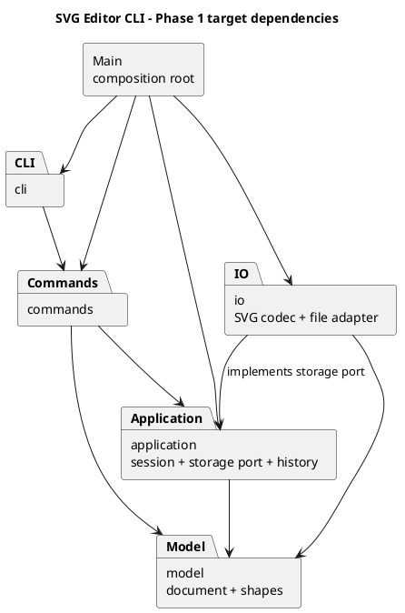

# Lab1 Phase 1：架构草案与开发记录

版本：v0.1，2026-10-30。当前处于里程碑 1（架构草案与项目骨架），下文明确区分已实现内容与后续设计。
需求依据为项目内的 [phase_cli_1.md](../phase_cli_1.md)。

## 一、架构方案

### 1. 范围与约束

本阶段使用 TypeScript、面向对象和 Command 模式，实现基于 ID 操作的 SVG CLI 编辑器。
内置类型仅为 `rect`、`circle`、`ellipse`、`line`、`text`、`g`；`box` 和动态插件系统属于后续阶段。
每个生产代码类单独一个同名文件；字段封装，图形行为通过多态表达，不采用公共数据袋配合过程式分派。

当前已实现：Node.js/TypeScript 工程配置、REPL、参数分词、命令分发、`help`、最小自动化检查。
图形模型、文档状态、SVG 读写和编辑历史均为后续里程碑内容，不能因目录已建立就认定功能已完成。

### 2. 模块划分

| 模块 | 职责与计划中的主要类 | 当前状态 |
|---|---|---|
| `src/Main.ts` | 组合根：创建对象、注册命令、注入依赖、启动程序 | 已实现最小组装 |
| `src/cli/` | `Repl` 处理终端输入输出；`CommandTokenizer` 处理空白、双引号、整行注释 | 已实现 |
| `src/commands/` | `Command`、`CommandDispatcher` 和具体命令；负责参数校验与用例调用，不操作终端或文件系统 | 基类、分发器、`HelpCommand` 已实现 |
| `src/application/` | 计划用 `EditorSession` 管理当前文档、文件路径、历史及 IO 后的撤销屏障；定义存储端口 | 目录占位 |
| `src/model/` | 计划用 `SvgDocument`、`Shape`、六种图形类管理几何、样式、父子关系、唯一 ID 与顺序 | 目录占位 |
| `src/io/` | 计划用 `SvgCodec` 转换 XML 与领域对象，`SvgFileStore` 通过文件系统实现存储端口 | 目录占位 |
| `tests/` | 自动化验收：当前为分词与 CLI 冒烟测试，后续增加模型、历史、IO 与场景测试 | 初始测试已建立 |
| `doc/` | 方案、PlantUML 图、真实过程记录、自查与质量说明 | 草案 |

图中的箭头表示“源码依赖”。这是目标架构；占位模块的连线尚未全部落地。
可渲染的图源同时保存在 [architecture.puml](architecture.puml)。

### 3. 设计模式的选择与落地

**Command（必须使用）**

当前 `HelpCommand` 继承 `Command`，`CommandDispatcher` 按命令名找到对象并调用 `execute`，REPL 不认识具体命令。
这只是命令对象化的起点，尚未实现可撤销命令。
后续增加 `EditCommand` 抽象，将执行和撤销行为封装到命令对象中，由历史管理器保存已执行实例。
分发入口可复用，但每次编辑必须创建独立实例，避免后一次执行覆盖前一次撤销所需的记录。
显示、文档操作与编辑命令的历史策略通过类的行为表达，不在多处判断命令字符串。

计划先采用文档快照辅助恢复：编辑命令保存执行前和执行后的模型快照；`undo` 恢复前态，`redo` 恢复后态。
快照由模型提供深复制能力，保留具体图形类型、属性、父子关系及节点顺序，不用 JSON 数据袋替代行为模型。
对作业规模而言，这比逐个编写 `group/delete/ungroup` 的逆操作更容易验证；代价是每个历史单元占用与文档大小成正比的内存。
若后续需要处理大文档，再将具体命令改为保存最小差异，命令调用协议保持稳定。

**Composite（需求要求的容器与叶子统一语义）**

计划定义抽象 `Shape`，封装 ID、父级和样式，并提供 `move/scale/set` 等操作。
`Rect/Circle/Ellipse/Line/Text` 实现各自几何行为，`Group` 递归组合子图形。
命令只调用抽象行为，不能到处 `switch(tag)`。
树结构的插入、删除、重排由模型管理，统一验证 ID 唯一性、父级合法性和无环约束。
普通组的 `set fill/stroke/stroke-width` 设置组自身的 SVG 样式属性，遵循 SVG 继承；不擅自改写已有显式子样式。
`box` 的定制属性传播不在本阶段实现。

**Factory（集中类型创建）**

计划让 `ShapeFactory` 集中处理类型名到图形类的映射，CLI 创建和 SVG 读入复用该入口。
图形自己的属性校验、显示描述和几何行为归相应类所有；工厂不承包图形行为。
SVG 编解码也应通过多态或注册的类型适配器工作，避免在读入和保存时分别新增按类型分派点。
可使用中立的 XML 节点描述作为模型与 IO 的转换边界；模型不导入具体 XML 库。

**按名字分派的两个允许位置与待重构项**

1. `CommandDispatcher`：命令名 → 命令实现，已存在；将随编辑命令加入改为按请求创建独立执行对象。后续插件化阶段再评估注册生命周期。
2. `ShapeFactory`：图形类型名 → 图形类，尚未实现；后续插件化阶段评估替换为 `ShapeProvider` 注册入口。

即使用映射表代替 `switch`，上述两处仍属于按名字分派，按作业要求列为待重构项。
本阶段不预先实现插件加载、发现或热更新。

### 4. 依赖方向规则

| 模块 | 允许依赖的项目模块 | 原因 |
|---|---|---|
| `model` | 本模块内部 | 图形规则不依赖终端、文件系统、命令或应用会话 |
| `application` | `model` | 统一调度文档和历史，存储能力通过自己定义的端口注入 |
| `commands` | `application`、`model` | 把用户意图转为模型操作，不决定具体 IO 实现 |
| `cli` | `commands` | 只做输入解析、命令调用、结果呈现；终端边界允许依赖 Node readline |
| `io` | `application` 的端口、`model` | 实现端口并适配文件系统/XML；应用层不反向导入 IO |
| `Main` | 所有生产模块 | 仅在组合根创建和连接具体对象 |
| `tests` | 被测试模块 | 测试可以跨层验证，生产代码不得导入测试 |

禁止循环依赖。`application → io`、`model → cli`、命令直接使用 `node:fs` 都是待处理的违规依赖。
接口使用 `import type` 表达纯类型依赖。当前没有必要额外引入依赖注入框架。

### 5. 关键行为决策

- **失败原子性**：先解析并校验，再提交修改。计划在候选文档副本上执行编辑，全部成功后替换当前文档并入栈；失败保留文档、路径和 undo/redo 栈。
- **历史粒度**：一条成功编辑命令一个单元。撤销后的新编辑清空 redo；失败编辑不清空 redo。显示命令不入栈。
- **文档屏障**：成功的 `init/read/save` 与带参数的 `canvas` 清空旧历史并锁定撤销重做，报规定错误，直到下一次成功编辑。无参数 `canvas` 仅查询；失败 IO 不改变历史。
- **容器操作**：移动和缩放对所有后代生效；缩放同时改变位置和尺寸，因子必须大于零。先以修改几何值实现编辑器自产 SVG，不用未经测试的 transform 替代命令语义。
- **顺序与结构**：模型保存有序子节点。恢复历史时同时恢复父级和原索引；根级 `<g>` 按题目要求禁止解组。加入自身或后代会形成环的操作必须拒绝。
- **ID**：创建与分组要求显式 ID，大小写敏感且全文档唯一。读入时先收集显式 ID，再为缺失项生成不冲突的“标签名+序号”，成功提交后输出警告。
- **文本与样式**：文本内容与 XML 属性分开存储，保存时分别转义。省略 fill/stroke 时保持属性缺省，不填入人为默认值。
- **CLI**：仅整行去掉前导空白后以 `#` 开头才视作注释；双引号保留空格与空字符串。当前未额外定义引号转义扩展。错误统一由 REPL 输出为单行 `error:`，帮助可在无文档时使用。

### 6. 变化点假设

| 可能变化 | 本阶段准备 | 暂不实现的部分及原因 |
|---|---|---|
| 更多图形与未来 `box` | 图形多态、集中工厂、统一子树操作 | 不实现插件加载器，当前只要求六种内置类型 |
| GUI 或 agent 入口 | 终端 IO 与命令对象分离 | 不做图形界面和网络服务 |
| SVG/XML 库或存储位置 | IO 适配器与存储端口 | 不做云存储、多个存储后端 |
| 更复杂撤销策略与大文档 | 独立历史策略，命令封装恢复行为 | 不提前优化快照为增量历史 |
| 新属性、输出格式 | 属性校验归图形类，终端渲染归 CLI | 不支持白名单以外的任意 SVG/CSS |

### 7. 待澄清的需求边界

以下是原说明尚不充分明确的部分；实现对应功能前应确认或记录可验证的约定：

- 跨父级 `group` 的新容器应放在哪里，“相对顺序”按参数顺序还是原文档遍历顺序解释。
- 外部 SVG 的 `transform`、未支持标签、复杂样式的读取范围。原文背景展示了 transform，但命令白名单不允许设置该属性；不能在读取时静默丢弃并声称完整支持。
- 无已读路径时执行无参数 `save` 的行为，以及 `save new.svg` 后是否更新默认路径。
- 空历史、非有限数值、负尺寸、重复显式 ID 等错误的确切措辞，原文没有全部列出；应保持统一错误格式和状态不变。

## 二、过程记录

只记录已发生的讨论和实际修改；后续测试结果和问题修复在发生后追加，不预写成功结论。

### 2026-10-30：里程碑 1

1. 用户先要求理解作业。阅读 `phase_cli_1.md`，确认 TypeScript 面向对象、Command 模式、Git 分步提交、文档与最终 `final` 标签是硬要求，`box` 不在本阶段范围。
2. 用户授权先完成架构草案、项目骨架、第一次提交，并提供 `sqaaia/svg-editor-cli` 仓库。
3. 检查工作区，发现 `hw1` 仅有作业说明，尚无 Git 仓库。选择以 `hw1` 为独立仓库根目录，保留原作业文件，避免把其他课程目录纳入这个仓库。
4. 在初步的 `cli/commands/model/io` 划分中补充 `application`，用于隔离会话、历史和存储端口，避免让 REPL 或命令分发器逐渐承担全部状态管理。这是架构草案的首次细化。
5. 决定先落地 `help` 与命令入口，不生成整套编辑器。帮助文本明确标注未来命令未实现，保留可核验的分步开发过程。
6. 初始检查覆盖引号文本、空文本、十六进制颜色，以及脚本输入遇错后继续执行。原因是整行注释与颜色都含 `#`，简单截断可能误删合法参数。

后续每个里程碑记录：具体问题 → 证据/复现 → 决策与修改 → 验证结果及对应提交。

## 三、一致性自查

### 1. 模块划分

当前目录与本版方案一致。`application/model/io` 只有 `.gitkeep`，是待实现模块；不能视为功能完成。
`src/Main.ts` 是唯一组合根，各生产类单独文件，文件名与类名一致。

### 2. 依赖方向

初始代码抽样：`Main → Repl/CommandDispatcher/HelpCommand`；`Repl → CommandDispatcher/CommandTokenizer`；
`HelpCommand/CommandDispatcher → Command`。`CommandTokenizer` 无项目外部依赖。
终端依赖留在 `Repl`，命令层通过返回值提供输出；未发现违反本版规则的依赖。
待未来模块实现后，重新检查实际 `import` 与模块图，不能沿用当前结论作为最终验收。

## 四、质量保证手段

### 1. 当前检查方式

- `npm run typecheck`：开启 TypeScript 严格检查、索引未定义检查及 override 检查。
- `npm test`：先构建，再使用 Node.js 内置测试运行器验证分词边界和真实 CLI 子进程。
- `npm run cli`：人工检查交互启动、`svg>` 提示符、`help` 和 EOF 退出。
- 依赖版本通过 `package-lock.json` 锁定；使用 `npm ci` 验证可重复安装。

当前测试只能证明骨架的有限行为，不能证明图形编辑、读写或历史功能完整。

2026-10-30 本地验证结果：Node.js v22.23.3、TypeScript 5.9.3；`npm run check` 通过，包含类型检查、构建及 2 项自动化测试。
另外以真实交互终端启动，确认启动横幅、`svg>` 提示符和 `help` 输出。

### 2. 后续验收计划

| 范围 | 必须验证的行为 |
|---|---|
| 图形模型 | 六种类型、几何属性、白名单、唯一 ID、组内递归移动缩放 |
| 结构编辑 | 跨父级分组、解组限制、addto 防环、删除子树、front/back 与兄弟顺序 |
| 历史 | 每条命令一单元、结构与顺序恢复、新编辑清 redo、失败不改状态、IO 屏障 |
| SVG IO | 保存再读回等价、文字转义、缺 ID 补全不冲突、非法 XML、读写失败 |
| CLI | 引号和注释、浮点参数、统一错误、tree/show 的属性与层级 |
| 端到端 | 回放第 6 节与第 6.1 节版本 A，在浏览器检查生成 SVG |
| 架构 | 核对类文件与模块图；扫描依赖与按类型分派，记录和修正偏差 |

### 3. 后续里程碑与提交约定

1. 当前：架构草案、工程配置、可运行 CLI 骨架。
2. 图形模型与组合结构，模型行为测试。
3. 最小编辑流程：init/create/tree/move。
4. 可撤销 Command、历史管理和其余编辑命令。
5. SVG 读写、显示完善、错误与边界处理。
6. 完整场景验收、架构一致性修订、文档收尾。

每一步先验证，再提交和推送；需要时可以拆成更多有意义的小提交。
当前不创建 `final` 标签。只有全部功能验收完成后才打标签并推送，且须早于课程截止时间（作业文件未注明具体日期）。
